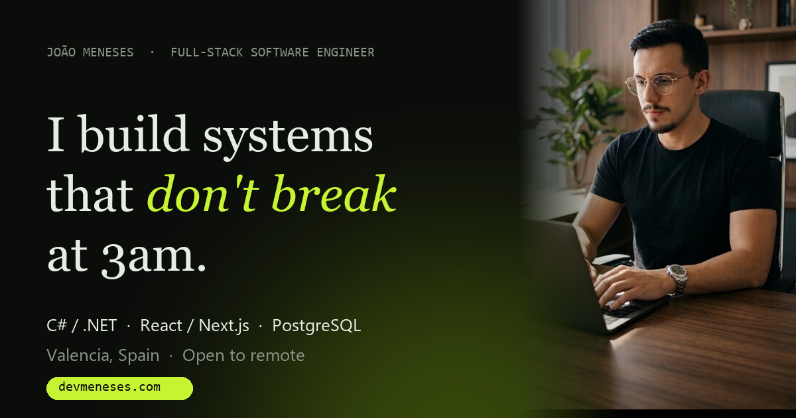

# devmeneses.com

Personal portfolio of **João Meneses**, Full-Stack Software Engineer (C# / .NET · React / Next.js · PostgreSQL).

**Live:** https://devmeneses.com · **Recruiter mode:** https://devmeneses.com/cv



## Highlights

- **Hero:** WebGL light beam made of "requests" (custom shaders, bloom) plus live glass dashboard cards with pointer tilt.
- **"What happens when you click Pay?":** a scroll-pinned 3D scene where a payment travels through 5 layers of a SaaS I built: API, auth/RLS, workers, PostgreSQL, outbox.
- **Selected work:** the ICone case study, CloudThreat Atlas, Novae Universe and more.
- **Journey:** dotted world map generated from Natural Earth data, with a plane flying Curitiba → Valencia.
- **Contact:** form styled as `POST /hire-joao`, backed by a Vercel function and Resend.
- **Recruiter mode (`/cv`):** a one-page, motion-free, printable résumé.
- EN / PT, `prefers-reduced-motion` support, lighter rendering on mobile and low-end GPUs, Open Graph and JSON-LD.

## Stack

Vite · React 19 · TypeScript · React Three Fiber · drei · postprocessing · GSAP ScrollTrigger · Lenis · Tailwind CSS v4 · Vercel Functions · Resend

## Run locally

```bash
npm install
npm run dev
```

Build with `npm run build`. Regenerate the map dots with `node scripts/build-map.mjs`.

### Environment (Vercel)

| Variable | Purpose |
| --- | --- |
| `RESEND_API_KEY` | Sends contact-form messages (required for the form) |
| `CONTACT_TO` | Recipient address (optional) |
| `CONTACT_FROM` | Verified Resend sender (optional) |

## Structure

```
src/sections   page sections (Hero, FollowRequest, Work, Journey, Stack, Contact, Footer, RecruiterMode)
src/scenes     WebGL scenes (HeroBeam, RequestJourney)
src/content    EN/PT copy, projects, map data
api/contact.ts contact form endpoint
```

© João Meneses. All rights reserved.
